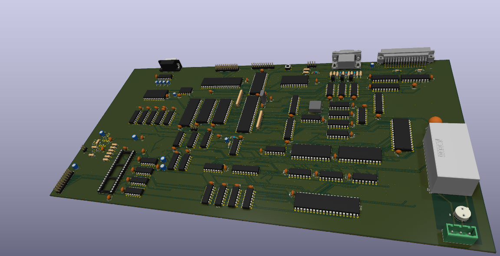

# OSM39

*English version below.*

Un ordinateur 8 bits fait maison autour d'un **Hitachi HD6309** à
1,8432 MHz, avec son système complet : un BIOS de 8 Ko en EPROM, un
bureau graphique en mode texte (OSM-VISION) et des programmes chargés
depuis une carte SD formatée dans un système de fichiers maison (OSMFS).



## Ce qu'il y a dedans

- **128 Ko de RAM** en 4 pages de 32 Ko, **vidéo 80 × 30** caractères
  (68B45, sortie VGA 640 × 480, 8 couleurs, police en EPROM avec une page
  de semi-graphiques), **clavier PS/2**, **carte SD** (SPI matériel),
  **son AY-3-8910** et 6840, **liaison série** 115200 bauds.
- **Logiciel** (tout en assembleur 6309) :
  - le BIOS : démarrage automatique depuis la carte SD, système de
    fichiers OSMFS avec dossiers, console, clavier, son, appels entre pages ;
  - OSM-VISION : gestionnaire de fichiers à fenêtres, menus, Terminal ;
    il se pilote aussi à la « Clouris », une souris tactile à clous ;
  - des applications : EDIT (éditeur façon WordStar), CALC (tableur façon
    VisiCalc), MINITEL (terminal Vidéotex, jusqu'à MiniPavi par un vrai
    modem), PAROLE (synthèse vocale en français), un lecteur de musique
    pour l'AY, et des jeux : GLOUTON, ENVAHIS, BRIQUES, DONJON39 (un
    labyrinthe en 3D) ;
  - un assembleur 6309 qui tourne sur la machine (sa sortie est identique,
    octet pour octet, à celle de lwasm), un FORTH, un SHELL et ses commandes ;
  - des outils PC : préparation de la carte SD (`tools/egofs`), pilotage
    à distance par la liaison série (`tools/tele`), simulations logiques
    des cartes à partir de leurs netlists KiCad.
- **Un manuel de l'utilisateur** : `docs/manuel/` (le PDF est joint aux
  versions publiées, voir « Releases »).

## État du matériel

- **Ce qui tourne aujourd'hui** est la version à plusieurs cartes (carte
  CPU, carte vidéo CRT2, carte SD-clavier-son) : tout le logiciel de ce
  dépôt y est essayé.
- **OSM39_mono** (`materiel/OSM39_mono`) réunit tout sur une seule carte.
  Elle est routée et commandée, **pas encore montée ni essayée**. Sa vidéo
  diffère (caractère et couleur entrelacés, mode graphique) : le logiciel
  devra être adapté quand elle arrivera. Utilisez ses fichiers en
  connaissance de cause.

## Construire le logiciel

Il faut **lwtools 4.24** (`lwasm`, `lwlink`), `objcopy` et `python3`.

```sh
make                 # BIOS, SHELL, FORTH, commandes, ASM, OSM-VISION
./deploy_sd.sh       # tout construire et vérifier, remplir dist/
```

`dist/EPROM/` contient l'image du BIOS (`osm39.bin`, 8 Ko) et la police
(`font_osm39.bin`) à graver ; `dist/SD/` et `dist/DEPLOY.md` décrivent la
carte SD. Pour l'écrire (sur une image de test d'abord, jamais sur le
mauvais périphérique !) :

```sh
python3 tools/egofs/egofs_deploy.py /dev/sdX
```

Au démarrage, le BIOS joue un petit air, affiche sa bannière et charge
OSM-VISION ; une touche dans la première seconde ouvre le moniteur de
secours (chargement Intel hex par la liaison série).

## Les vérificateurs

Le dossier `test/` contient des vérificateurs qui font tourner les vrais
binaires dans un émulateur 6309 (avec la carte SD, le clavier, l'AY... en
modèles) et les comparent à des modèles exacts en Python :

```sh
make -C test bureau      # OSM-VISION au clavier et à la Clouris
make -C test donjon39    # le rendu 3D comparé au modèle
make -C test minitel     # le décodeur Vidéotex et le protocole PCE
```

`AGENTS.md` est la documentation technique de référence (en anglais), et
`docs/memory-map.md` la carte mémoire.

## Ce qui n'est pas ici

- **BBC BASIC** : la machine fait tourner le portage 6809/6309 de BBC BASIC
  IV par Dominic Beesley (<https://github.com/dominicbeesley/beeb6809>).
  Ce dépôt amont n'a pas de licence : ni lui ni la couche d'adaptation
  d'OSM39 ne sont publiés ici. Le manuel en parle quand même.
- Le BASIC d'origine Microsoft (« basic69 ») non plus.
- Les modèles 3D des connecteurs et de l'alimentation (`.STEP`) : ils se
  téléchargent chez les fabricants (Amphenol 86093487313H55ELF, Amphenol
  L77HDE15SD1CH4FVGA, Recom RAC20-05SK).

## Licences

- Matériel (`materiel/`) : **CERN-OHL-S v2** (`materiel/LICENSE`).
- Logiciel : **GPL v3 ou ultérieure** (`LICENSE`).
- Manuel et documentation : **CC BY-SA 4.0** (`docs/LICENSE`).
- `tools/manuel/polices/` : les polices gardent leur licence (SIL OFL).

## Crédits

- Les captures de pages Vidéotex de `tools/minitel/*.vdt`, qui servent aux
  vérificateurs, viennent du serveur **MiniPavi** (`go.minipavi.fr`).

---

# OSM39 (English)

A home-made 8-bit computer built around a **Hitachi HD6309** at
1.8432 MHz, with its whole system: an 8 KB EPROM BIOS, a text-mode
windowed desktop (OSM-VISION) and programs loaded from an SD card
formatted with a home-made file system (OSMFS). Comments, messages and
the user manual are in French.

- **Hardware**: 128 KB RAM in four 32 KB pages, 80 × 30 text video
  (68B45, VGA output, 8 colours, EPROM font with a semigraphics page),
  PS/2 keyboard, SD card on hardware SPI, AY-3-8910 and 6840 sound,
  115200 baud serial line.
- **Software** (6309 assembly): BIOS with auto-boot and a file system
  with folders; OSM-VISION file manager; an editor, a spreadsheet, a
  Videotex terminal, French text-to-speech, an AY music player, games; a
  native 6309 assembler (byte-identical to lwasm), FORTH, a shell; PC
  tools to build the SD card, drive the machine over the serial line and
  simulate the boards from their KiCad netlists.
- **Status**: the software runs on the multi-board machine (CPU, CRT2
  video, SD-keyboard-sound). **OSM39_mono**, the single-board version in
  `materiel/OSM39_mono`, is routed and ordered but **not yet built or
  tested**; its video differs and the software will need adapting.
- **Build**: lwtools 4.24, `objcopy`, `python3`; `make`, then
  `./deploy_sd.sh` fills `dist/` (EPROM images, SD card contents).
  `make -C test <name>` runs the verifiers (real binaries in a 6309
  emulator, compared with exact Python models).
- **Not included**: BBC BASIC (Dominic Beesley's 6809 port has no
  licence) and the Microsoft-derived BASIC; vendor 3D models.
- **Licences**: hardware CERN-OHL-S v2, software GPL v3 or later,
  documentation CC BY-SA 4.0.
